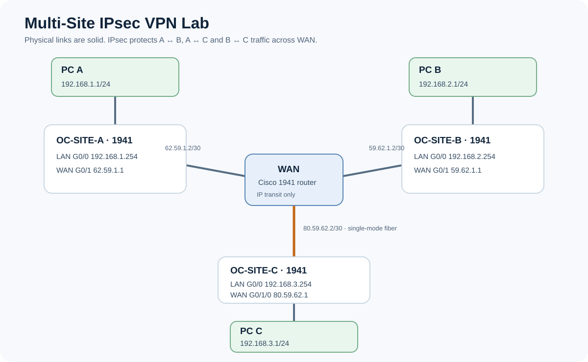

# Multi-Site IPsec VPN Lab

A three-site, site-to-site IPsec lab built in Cisco Packet Tracer with Cisco 1941 routers. Each site has a private LAN. A WAN router connects the three sites, while IPsec protects traffic between their LANs.

This lab follows the [OpenClassrooms IPsec course](https://openclassrooms.com/fr/courses/8787276-mettez-en-place-un-vpn-ipsec-dans-cisco-packet-tracer/8928281-configurez-ipsec). I built and tested the topology in Packet Tracer as a learning exercise. The repository layout is inspired by [this campus network portfolio repository](https://github.com/pratapgoudaila/Enterprise-Campus-Network-Lab); the network here is a separate VPN project.

## Project Overview

**Objective:** Build and validate secure site-to-site connectivity between three branch offices using Cisco IPsec VPNs.

**Environment:** Cisco Packet Tracer, Cisco 1941 routers.

**Technologies:** IKEv1, IPsec ESP, AES-256, crypto maps, NAT exemption, static routing and ACLs.

**Architecture:** Three branch LANs interconnected through a simulated WAN with three pairwise IPsec VPN connections.

**Validated Results:**

- Successful ICMP connectivity from Site C to Site B (4/4 replies).
- Active IKE security associations observed on Site C.
- ESP security associations and packet encryption/decryption counters examined.
- Further verification required to capture complete results for all site pairs.

**Learning Outcome:** Gained hands-on experience configuring IPsec tunnels, understanding NAT exemption, inspecting security associations and documenting VPN verification.

**Scope:** Guided educational lab based on an OpenClassrooms course. Additional testing and troubleshooting improvements are planned.

## Repository layout

| Path | Contents |
| --- | --- |
| [`VPN-IPsec-Multi-Site-Lab.pkt`](VPN-IPsec-Multi-Site-Lab.pkt) | Saved Packet Tracer lab |
| [`configs/`](configs/) | Reconstructed command reference for each router |
| [`documentation/`](documentation/) | Network design and reproduction notes |
| [`topology/`](topology/) | Network diagram |
| [`verification/`](verification/) | Captured CLI and ping evidence |

## Technologies

- IKEv1 / ISAKMP with pre-shared keys, AES-256, SHA and Diffie-Hellman group 5
- IPsec ESP with AES-256 and SHA-HMAC
- Crypto map entries for three site pairs
- NAT overload for ordinary outbound traffic, with NAT exemptions for VPN traffic
- Static routes and a single-mode fiber link between WAN and Site C

## Topology and IP plan

| Device | LAN interface | WAN interface | LAN host |
| --- | --- | --- | --- |
| OC-SITE-A | G0/0 `192.168.1.254/24` | G0/1 `62.59.1.1/30` | `192.168.1.1/24` |
| OC-SITE-B | G0/0 `192.168.2.254/24` | G0/1 `59.62.1.1/30` | `192.168.2.1/24` |
| OC-SITE-C | G0/0 `192.168.3.254/24` | G0/1/0 `80.59.62.1/30` | `192.168.3.1/24` |
| WAN | — | G0/0 `62.59.1.2/30`; G0/1 `59.62.1.2/30`; G0/1/0 `80.59.62.2/30` | — |

Each PC uses its site's `.254` address as its default gateway. Site C uses a HWIC-1GE-SFP card and GLC-LH-SMD transceiver at each end of its fiber link to WAN.

## VPN matrix

| Tunnel | Protected networks | Crypto map entries | Peer addresses |
| --- | --- | --- | --- |
| A ↔ B | `192.168.1.0/24` ↔ `192.168.2.0/24` | A `OCMAP 10`, B `OCMAP 10` | `62.59.1.1` ↔ `59.62.1.1` |
| A ↔ C | `192.168.1.0/24` ↔ `192.168.3.0/24` | A `OCMAP 20`, C `OCMAP 20` | `62.59.1.1` ↔ `80.59.62.1` |
| B ↔ C | `192.168.2.0/24` ↔ `192.168.3.0/24` | B `OCMAP 30`, C `OCMAP 30` | `59.62.1.1` ↔ `80.59.62.1` |

The WAN router forwards traffic between the public-facing interfaces; the site routers terminate the VPNs. The `deny` entries in each NAT selection ACL exclude inter-site traffic from address translation. Separate VPN ACLs select that traffic for encryption.

## Verification

- PC C → PC B (`192.168.2.1`): **4 replies from 4 packets** in the [captured ping](verification/c-to-b-ping.txt).
- OC-SITE-C reported `QM_IDLE ACTIVE` for peers A and B in the [IKE output](verification/c-isakmp-sa.txt).
- The captured C ↔ A IPsec output reported 5 encrypted and 4 decrypted packets. For C ↔ B, the outbound ESP SPI on C matched the inbound ESP SPI on B; see [IPsec observations](verification/ipsec-observations.md).
- PC C → PC A and PC A → PC B pings were also reported successful during the guided lab. Their full CLI transcripts have not been captured in this repository.

Open the `.pkt` file in Packet Tracer and repeat the [verification procedure](documentation/reproduce-and-verify.md) to observe current counters. IPsec associations form on demand, so an idle tunnel may show zero packet counters until a new ping crosses it.

## Lab scope

This project is a Cisco Packet Tracer simulation developed for educational purposes as part of a networking course.

The pre-shared keys (PSKs) used in this lab are for demonstration purposes only and must never be reused in a production network.

Although the ping tests were successful, the captured outputs show non-zero receive-error counters on OC-SITE-C. These counters are explicitly documented in the verification notes to ensure transparency.

Additionally, Packet Tracer displays zero digest and verification counters in this exercise, as described in the [course](https://openclassrooms.com/fr/courses/8787276-mettez-en-place-un-vpn-ipsec-dans-cisco-packet-tracer/8928281-configurez-ipsec).
